# Mermaid-Seitengrammatik I · Bürger-KI und Kernseiten
**Stand 2026-11-05 · zwei redaktionelle Strukturentwürfe pro Seite, aus realen Überschriften abgeleitet; keine geprüften Geschäftsprozesse.**

## [Forschungsdaten, Begriffe und Quellen](./bibliothek.html)
**Gliederung:** Forschungsdaten, Begriffe und Quellen; Formelernte und wissenschaftliches Harvesting; Codebuch, Glossar, Quellen und Formelernte; Welche Datenbestände gibt es?; No-Loss-Archiv; Trinitäten; Mathematische Signaturen

**Diagramm 1 – Lese- und Forschungsfolge**
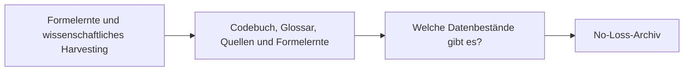

**Diagramm 2 – Evidenz- und Mitmachpfad**


## [Viele Lebensbereiche. Gemeinsame Fähigkeiten.](./buerger-ki-anwendungsfelder.html)
**Gliederung:** Viele Lebensbereiche. Gemeinsame Fähigkeiten.; Gesundheit: Therapieplatz aus fünf Perspektiven; Wobei könnte Bürger-KI helfen?; Gesundheit Psychotherapie; Patientenrechte Gesundheitswissen; Existenzsicherung Sozialleistungen; Wohnen Energie

**Diagramm 1 – Lese- und Forschungsfolge**
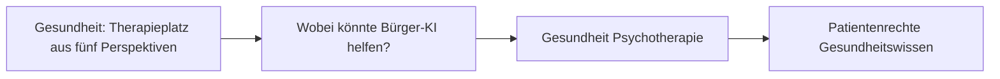

**Diagramm 2 – Evidenz- und Mitmachpfad**
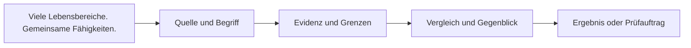


## [Bürger-KI: Blickwinkel Therapieplatz](./buerger-ki-blickwinkel-therapieplatz.html)
**Gliederung:** Bürger-KI: Blickwinkel Therapieplatz; Aus welchem Blickwinkel möchtest du einsteigen?; Die Perspektiven entfalten sich hier; Spiegelungen: anders auf dasselbe Thema blicken; Wo tiefer gehen – und wo verweisen?

**Diagramm 1 – Lese- und Forschungsfolge**
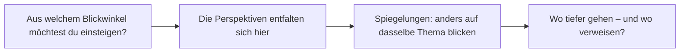

**Diagramm 2 – Evidenz- und Mitmachpfad**
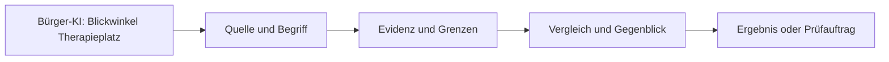


## [Corona: Welche Probleme wurden wann sichtbar – und was wurde daraufhin g](./buerger-ki-corona-zeitverlauf.html)
**Gliederung:** Corona: Welche Probleme wurden wann sichtbar – und was wurde daraufhin g; So funktioniert der fachliche Rückblick; Welche Überlastungen und Schutzfolgen müssten wir messen?; Infektion und Krankheit; Behandlung und Personal; Schule und Teilhabe; Staatliche Organisation

**Diagramm 1 – Lese- und Forschungsfolge**
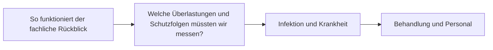

**Diagramm 2 – Evidenz- und Mitmachpfad**
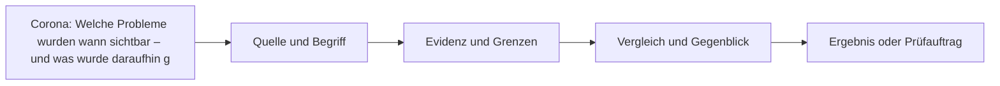


## [Wo steckt der Verwaltungs-Fail?](./buerger-ki-fail-scanner.html)
**Gliederung:** Wo steckt der Verwaltungs-Fail?; 1 · Daten auswählen; 2 · Ergebnis und offene Wissensfelder; 3 · Weiterverwenden

**Diagramm 1 – Lese- und Forschungsfolge**
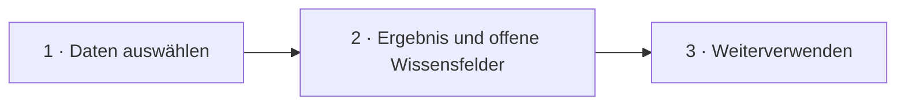

**Diagramm 2 – Evidenz- und Mitmachpfad**
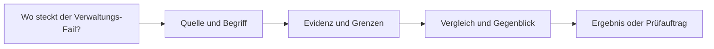


## [Jemand hat jemandem geholfen. Was lässt sich daraus lernen?](./buerger-ki-feedback.html)
**Gliederung:** Jemand hat jemandem geholfen. Was lässt sich daraus lernen?; Eine Quelle verbessern oder eine Idee teilen; Redaktionell Kontakt aufnehmen; Welche Hinweise helfen wirklich weiter?; Was geschieht danach?

**Diagramm 1 – Lese- und Forschungsfolge**
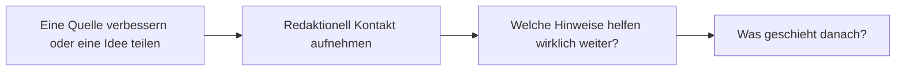

**Diagramm 2 – Evidenz- und Mitmachpfad**
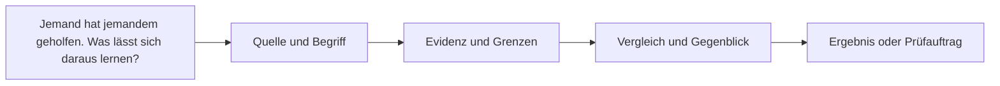


## [Wissen verbinden. Vertiefungen finden.](./buerger-ki-forschungsbibliothek.html)
**Gliederung:** Wissen verbinden. Vertiefungen finden.; Welche Reihenfolge ist sinnvoll?

**Diagramm 1 – Lese- und Forschungsfolge**
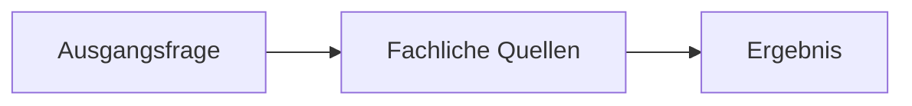

**Diagramm 2 – Evidenz- und Mitmachpfad**
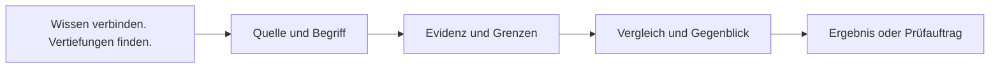


## [Unser gemeinsames Problem](./buerger-ki-gemeinsam.html)
**Gliederung:** Unser gemeinsames Problem; Bestehende Netzwerke stärken, nicht ersetzen; Bestehendes Angebot; Bürger-KI als Ergänzung; Pilot Psychotherapie: kein künstlicher Neustart; Gemeinsame Ergebnismessung; Gemeinsame Fähigkeiten statt gemeinsamer Fallverwaltung

**Diagramm 1 – Lese- und Forschungsfolge**
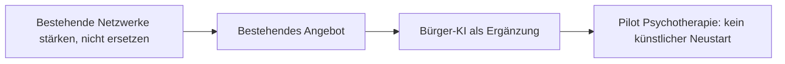

**Diagramm 2 – Evidenz- und Mitmachpfad**
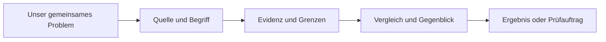


## [Unsere gesellschaftlichen Grundlagen](./buerger-ki-grundlagen.html)
**Gliederung:** Unsere gesellschaftlichen Grundlagen; Ein gesellschaftliches Versprechen ist nicht automatisch ein einklagbare; Sozialstaatsziele; Tatsächliche Erbringung; Verfassungsrahmen; Vier gesellschaftliche Säulen als Prüffälle; Wie erkennen wir, dass eine Säule substanziell angegriffen oder geschwäc

**Diagramm 1 – Lese- und Forschungsfolge**
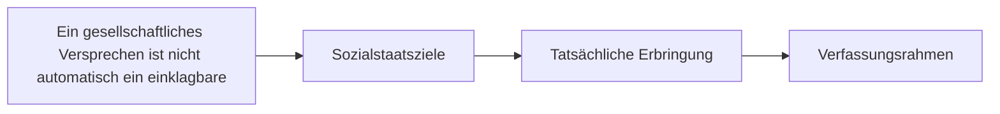

**Diagramm 2 – Evidenz- und Mitmachpfad**
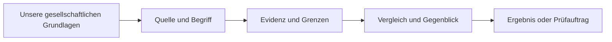


## [Was ich alle Arbeitslosen schon immer fragen wollte …](./buerger-ki-kaffeekraenzchen-fragen.html)
**Gliederung:** Was ich alle Arbeitslosen schon immer fragen wollte …; Frage oder Antwort vorschlagen; Was geschieht mit deinem Beitrag?

**Diagramm 1 – Lese- und Forschungsfolge**
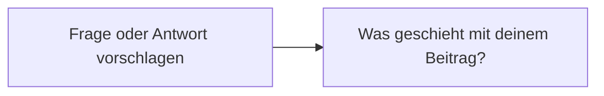

**Diagramm 2 – Evidenz- und Mitmachpfad**
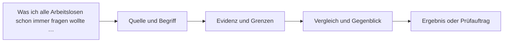


## [Kaffeekränzchen. Gemeinsam den Weg finden.](./buerger-ki-kaffeekraenzchen.html)
**Gliederung:** Kaffeekränzchen. Gemeinsam den Weg finden.; Fünf Ideen – von klein und praktisch bis zur größeren Frage; Gemeinsam anfangen; Den Dschungel durchblicken; Mitmachen beim Digital Independence Day; Perspektiven gemeinsam erleben?; Projekte kennenlernen

**Diagramm 1 – Lese- und Forschungsfolge**
```mermaid
flowchart LR
S0["Fünf Ideen – von klein und praktisch bis zur größeren Frage"]
S1["Gemeinsam anfangen"]
S2["Den Dschungel durchblicken"]
S3["Mitmachen beim Digital Independence Day"]
S0 --> S1
S1 --> S2
S2 --> S3
```

**Diagramm 2 – Evidenz- und Mitmachpfad**
```mermaid
flowchart LR
F["Kaffeekränzchen. Gemeinsam den Weg finden."] --> Q["Quelle und Begriff"]
Q --> E["Evidenz und Grenzen"]
E --> V["Vergleich und Gegenblick"]
V --> R["Ergebnis oder Prüfauftrag"]
```


## [Fünf Wege durch die Bürger-KI](./buerger-ki-lernpfade.html)
**Gliederung:** Fünf Wege durch die Bürger-KI; Welcher Lernweg passt zu meiner Frage?; Große Einstiege; Fachgebiete sind Filter, keine zusätzlichen Hauptmenüs; Kernthema als didaktischer Anker: Therapieplatz; Wo geht Forschung hin?; Erkenntnis gewinnt neue Quelle

**Diagramm 1 – Lese- und Forschungsfolge**
```mermaid
flowchart LR
S0["Welcher Lernweg passt zu meiner Frage?"]
S1["Große Einstiege"]
S2["Fachgebiete sind Filter, keine zusätzlichen Hauptmenüs"]
S3["Kernthema als didaktischer Anker: Therapieplatz"]
S0 --> S1
S1 --> S2
S2 --> S3
```

**Diagramm 2 – Evidenz- und Mitmachpfad**
```mermaid
flowchart LR
F["Fünf Wege durch die Bürger-KI"] --> Q["Quelle und Begriff"]
Q --> E["Evidenz und Grenzen"]
E --> V["Vergleich und Gegenblick"]
V --> R["Ergebnis oder Prüfauftrag"]
```


## [Mein Recht](./buerger-ki-mein-recht.html)
**Gliederung:** Mein Recht; Das Recht steht am Anfang – nicht die Bewilligung.; Zwei Beispiele – dieselbe Methode; Sozialleistung nicht gezahlt; Notwendige Psychotherapie nicht erreichbar; Was ein guter Bürger-KI-Skill können muss; Die Nachweisfrage wird präzise

**Diagramm 1 – Lese- und Forschungsfolge**
```mermaid
flowchart LR
S0["Das Recht steht am Anfang – nicht die Bewilligung."]
S1["Zwei Beispiele – dieselbe Methode"]
S2["Sozialleistung nicht gezahlt"]
S3["Notwendige Psychotherapie nicht erreichbar"]
S0 --> S1
S1 --> S2
S2 --> S3
```

**Diagramm 2 – Evidenz- und Mitmachpfad**
```mermaid
flowchart LR
F["Mein Recht"] --> Q["Quelle und Begriff"]
Q --> E["Evidenz und Grenzen"]
E --> V["Vergleich und Gegenblick"]
V --> R["Ergebnis oder Prüfauftrag"]
```


## [Evidente Evidenz Rechenschaft 100](./buerger-ki-rechenschaft-100.html)
**Gliederung:** Evidente Evidenz Rechenschaft 100; Zweiter 100er-Test: Sondervermögen; Der Forschungsstand – kein Urteil über die Bundesregierung; Fünf Fragen an jede Entscheidung; Eigene öffentliche Regierungsdaten lokal untersuchen; Vorhaben und offene Messfragen entdecken; Eine Erkenntnis ergänzen – ohne persönliche Fallakten

**Diagramm 1 – Lese- und Forschungsfolge**
```mermaid
flowchart LR
S0["Zweiter 100er-Test: Sondervermögen"]
S1["Der Forschungsstand – kein Urteil über die Bundesregierung"]
S2["Fünf Fragen an jede Entscheidung"]
S3["Eigene öffentliche Regierungsdaten lokal untersuchen"]
S0 --> S1
S1 --> S2
S2 --> S3
```

**Diagramm 2 – Evidenz- und Mitmachpfad**
```mermaid
flowchart LR
F["Evidente Evidenz Rechenschaft 100"] --> Q["Quelle und Begriff"]
Q --> E["Evidenz und Grenzen"]
E --> V["Vergleich und Gegenblick"]
V --> R["Ergebnis oder Prüfauftrag"]
```


## [Schutzpflichten, Rechtsverletzungen und vermeidbare Schäden](./buerger-ki-schutzpflichten.html)
**Gliederung:** Schutzpflichten, Rechtsverletzungen und vermeidbare Schäden; Schaden ist nicht automatisch Rechtsverletzung – und eine Rechtsverletzu; Rechtliche Position; Messbare Folgen; Abhilfe und Verantwortung; Was ist tatsächlich rechtlich geschützt?; Recht auf notwendige Behandlung

**Diagramm 1 – Lese- und Forschungsfolge**
```mermaid
flowchart LR
S0["Schaden ist nicht automatisch Rechtsverletzung – und eine Rechtsverletzu"]
S1["Rechtliche Position"]
S2["Messbare Folgen"]
S3["Abhilfe und Verantwortung"]
S0 --> S1
S1 --> S2
S2 --> S3
```

**Diagramm 2 – Evidenz- und Mitmachpfad**
```mermaid
flowchart LR
F["Schutzpflichten, Rechtsverletzungen und vermeidbare Schäden"] --> Q["Quelle und Begriff"]
Q --> E["Evidenz und Grenzen"]
E --> V["Vergleich und Gegenblick"]
V --> R["Ergebnis oder Prüfauftrag"]
```


## [Skills und Werkzeuge](./buerger-ki-skillzentrum.html)
**Gliederung:** Skills und Werkzeuge

**Diagramm 1 – Lese- und Forschungsfolge**
```mermaid
flowchart LR
S0["Ausgangsfrage"]
S1["Fachliche Quellen"]
S2["Ergebnis"]
S0 --> S1
S1 --> S2
```

**Diagramm 2 – Evidenz- und Mitmachpfad**
```mermaid
flowchart LR
F["Skills und Werkzeuge"] --> Q["Quelle und Begriff"]
Q --> E["Evidenz und Grenzen"]
E --> V["Vergleich und Gegenblick"]
V --> R["Ergebnis oder Prüfauftrag"]
```
