# Mermaid-Seitengrammatik II · Fach- und Datenseiten
**Entwürfe aus realen Überschriften · nicht fachlich validierte Prozesse**
## [Sondervermögen: 100 Posten. Welche Wirkung?](./buerger-ki-svik-100.html)
**Anker:** Sondervermögen: 100 Posten. Welche Wirkung? · Was ist der Datensatz? · 1 · Einen Posten finden · 2 · Fehlende Information ergänzen · 3 · An anderer amtlicher Liste vergleichen

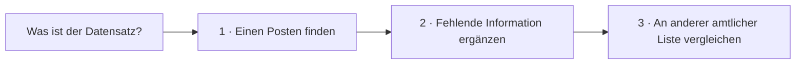

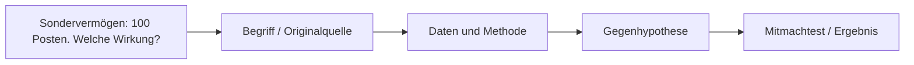

## [Drei Verwaltungsleistungen, neun Referenzfragen](./buerger-ki-verwaltungspilot.html)
**Anker:** Drei Verwaltungsleistungen, neun Referenzfragen · 1 · Referenzfrage auswählen · Quellen des Leistungsbereichs · 2 · Strategien unter gleichen Bedingungen ausführen · 3 · Ergebnisse und Fehler vergleichen · 4 · Fachlücken und nächster Ausbau

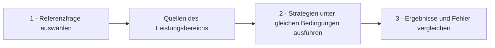

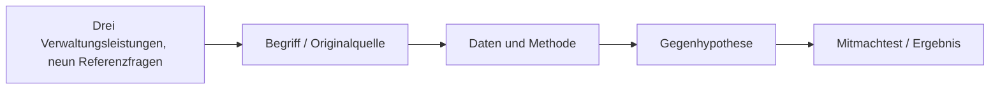

## [Vom Anliegen zur Lösung.](./buerger-ki-weg.html)
**Anker:** Vom Anliegen zur Lösung. · Sieben Fragen bringen Klarheit. · Ziel klären · Möglichkeiten erkennen · Wissen prüfen · Lücke erkennen · Gegenprobe machen · Handlungsweg wählen

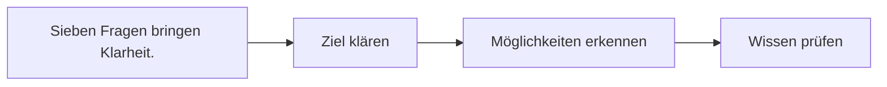

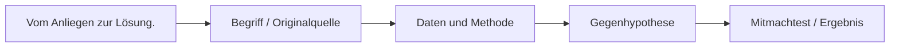

## [Weisungsatlas der deutschen Verwaltung](./buerger-ki-weisungsatlas.html)
**Anker:** Weisungsatlas der deutschen Verwaltung · Bund und nachgeordnete Behörden · 16 Bundesländer · geografische Rechercheebene · Weitere Fundkanäle: Transparenz und FragDenStaat · Von Dokumenten zu prüfbaren Regelatomen

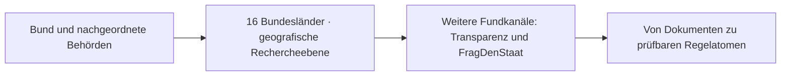

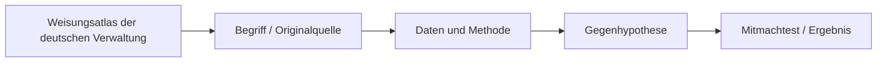

## [Bürger-KI: Fragen, testen, vergleichen, verbessern](./buerger-ki-werkstatt.html)
**Anker:** Bürger-KI: Fragen, testen, vergleichen, verbessern · 1. Fragen – passenden Test finden · 2. Ausprobieren – drei Strategien · 3. Vergleichen – überprüfbare Ergebnisse · 4. Verbessern – Änderung vorschlagen · Forschungsunterlagen · Öffentliche Daten prüfen

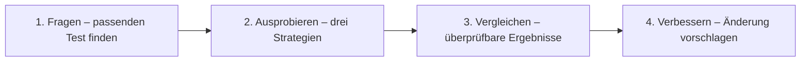

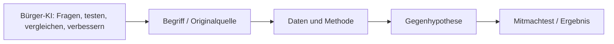

## [Begriffe verstehen, Ziele erkennen, Wege erschließen](./buerger-ki-ziele-lexikon.html)
**Anker:** Begriffe verstehen, Ziele erkennen, Wege erschließen · Quellen, Begriffsidentität und Grenzen

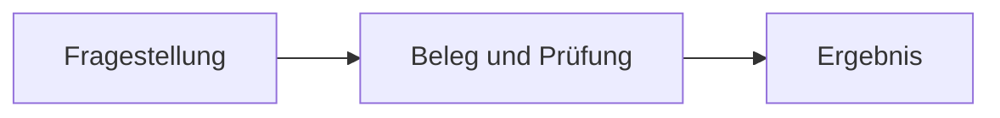

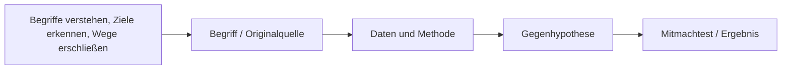

## [Vom Anliegen zu überprüfbaren Zielen und Wegen](./buerger-ki-zielpfade.html)
**Anker:** Vom Anliegen zu überprüfbaren Zielen und Wegen · Was macht daraus einen fairen Test?


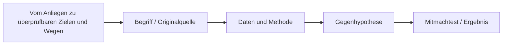

## [Rechte verstehen. Tatsächliche Erfüllung prüfen.](./buerger-ki.html)
**Anker:** Rechte verstehen. Tatsächliche Erfüllung prüfen. · Vernetzte Fähigkeiten. Mehr Handlungsmöglichkeiten. · Wissen verbinden · Skills kombinieren · Über Fachgrenzen nutzen · Bestehende Hilfe erschließen · Aus Prüfungen lernen · Wirkung statt Technik zählen

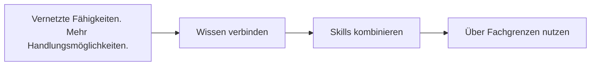

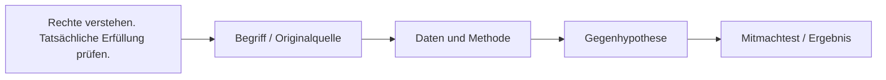

## [Codebuch · erster navigierbarer Objektindex](./codebuch.html)
**Anker:** Codebuch · erster navigierbarer Objektindex · Objekttypen und Begriffe · Wie kann der Bestand wachsen?

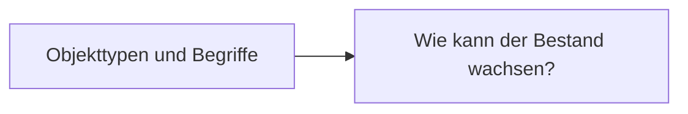

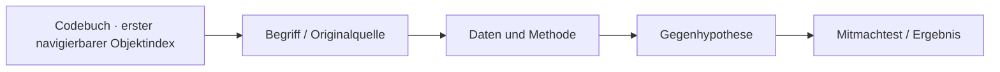

## [Tensoren und Skills – die Daten selbst ansehen](./forschungsdaten.html)
**Anker:** Tensoren und Skills – die Daten selbst ansehen · Öffentliches, versioniertes Forschungsinventar · Was bedeuten diese Daten – und was noch nicht? · 103 historische Tensorgerüste · 13 im Code vorhandene Funktionen · 8 Interoperabilitätsfamilien · Offene Daten, Quellen und Anschlussarbeiten · JSON · 103 Tensorgerüste

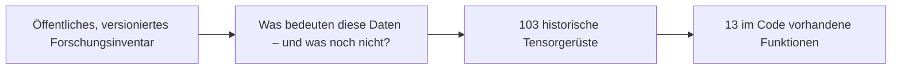

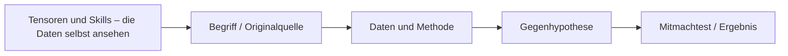

## [Welche Geometrie-KIs, Softwarebibliotheken und Geodatenbanken gibt es berei](./geoki-systeme.html)
**Anker:** Welche Geometrie-KIs, Softwarebibliotheken und Geodatenbanken gibt es berei · Was braucht man vorher zu wissen? · Geometrie · Operator · Geo-KI · 1. Bereits vorhandene Geometriebibliotheken · SymPy Geometry · GEOS / Shapely

```mermaid
flowchart LR
P0["Was braucht man vorher zu wissen?"]
P1["Geometrie"]
P2["Operator"]
P3["Geo-KI"]
P0 --> P1
P1 --> P2
P2 --> P3
```

```mermaid
flowchart LR
A["Welche Geometrie-KIs, Softwarebibliotheken und Geodatenbanken gibt es berei"] --> B["Begriff / Originalquelle"] --> C["Daten und Methode"] --> D["Gegenhypothese"] --> E["Mitmachtest / Ergebnis"]
```

## [Aus einer Regel entstehen Formen – aus Prüfungen entsteht Wissen.](./geoki.html)
**Anker:** Aus einer Regel entstehen Formen – aus Prüfungen entsteht Wissen. · Eine mathematische Regel, drei Beobachtungen · 1 · Eingabe · 2 · Operator · 3 · Ergebnis Invariante · Drehwinkel verändern und das Ergebnis beobachten · Rotation · Was ist daran überprüfbar?

```mermaid
flowchart LR
P0["Eine mathematische Regel, drei Beobachtungen"]
P1["1 · Eingabe"]
P2["2 · Operator"]
P3["3 · Ergebnis Invariante"]
P0 --> P1
P1 --> P2
P2 --> P3
```

```mermaid
flowchart LR
A["Aus einer Regel entstehen Formen – aus Prüfungen entsteht Wissen."] --> B["Begriff / Originalquelle"] --> C["Daten und Methode"] --> D["Gegenhypothese"] --> E["Mitmachtest / Ergebnis"]
```

## [Glossar und Codebuch](./glossar.html)
**Anker:** Glossar und Codebuch · Bestandsübersicht · Glossar und Codebuch vervollständigen – ein offener Mitmach-Task · Was noch fehlt · Wie weit sind unsere Begriffe geprüft? · Provenienz, Forschungsobjekt, Workflow und weitere Standardbegriffe

```mermaid
flowchart LR
P0["Bestandsübersicht"]
P1["Glossar und Codebuch vervollständigen – ein offener Mitmach-Task"]
P2["Was noch fehlt"]
P3["Wie weit sind unsere Begriffe geprüft?"]
P0 --> P1
P1 --> P2
P2 --> P3
```

```mermaid
flowchart LR
A["Glossar und Codebuch"] --> B["Begriff / Originalquelle"] --> C["Daten und Methode"] --> D["Gegenhypothese"] --> E["Mitmachtest / Ergebnis"]
```

## [Wie aus 7.622 Formeln prüfbare Relationen werden](./harvesting.html)
**Anker:** Wie aus 7.622 Formeln prüfbare Relationen werden · Verarbeitungskette · Gesicherte Zwischenprodukte · Von einer gefundenen Trinität zum prüfbaren Tensor · 1 · Dreiermuster · 2 · Mathematik · 3 · Anschlussmodelle · 4 · 27 Feldprüfungen

```mermaid
flowchart LR
P0["Verarbeitungskette"]
P1["Gesicherte Zwischenprodukte"]
P2["Von einer gefundenen Trinität zum prüfbaren Tensor"]
P3["1 · Dreiermuster"]
P0 --> P1
P1 --> P2
P2 --> P3
```

```mermaid
flowchart LR
A["Wie aus 7.622 Formeln prüfbare Relationen werden"] --> B["Begriff / Originalquelle"] --> C["Daten und Methode"] --> D["Gegenhypothese"] --> E["Mitmachtest / Ergebnis"]
```

## [Impressum & Datenschutz](./impressum.html)
**Anker:** Impressum & Datenschutz · Impressum · Datenschutzerklärung · Bereitstellung und Hosting · Externe Ressourcen und GitHub-Verzeichnis · Kontaktaufnahme · Cookies und Reichweitenanalyse · Ihre Rechte

```mermaid
flowchart LR
P0["Impressum"]
P1["Datenschutzerklärung"]
P2["Bereitstellung und Hosting"]
P3["Externe Ressourcen und GitHub-Verzeichnis"]
P0 --> P1
P1 --> P2
P2 --> P3
```

```mermaid
flowchart LR
A["Impressum & Datenschutz"] --> B["Begriff / Originalquelle"] --> C["Daten und Methode"] --> D["Gegenhypothese"] --> E["Mitmachtest / Ergebnis"]
```

## [Wie entstehen kleine KI-Systeme aus wissenschaftlichen Beziehungen?](./index.html)
**Anker:** Wie entstehen kleine KI-Systeme aus wissenschaftlichen Beziehungen? · Vier Kernprojekte · ein gemeinsamer Forschungszusammenhang · Mini-KI · Komprimierung · Visuelle Engine · Geo-KI · Wie hängen diese Projekte zusammen? · Wo stehen wir?

```mermaid
flowchart LR
P0["Vier Kernprojekte · ein gemeinsamer Forschungszusammenhang"]
P1["Mini-KI"]
P2["Komprimierung"]
P3["Visuelle Engine"]
P0 --> P1
P1 --> P2
P2 --> P3
```

```mermaid
flowchart LR
A["Wie entstehen kleine KI-Systeme aus wissenschaftlichen Beziehungen?"] --> B["Begriff / Originalquelle"] --> C["Daten und Methode"] --> D["Gegenhypothese"] --> E["Mitmachtest / Ergebnis"]
```
