# Mermaid-Seitengrammatik III · Anwendungen und Publikationen
**Vorlagen, keine realen Erfolgsbehauptungen; mit tatsächlichen Überschriften verknüpft.**
## [Forschungsinkubator](./inkubator.html)
**Anker:** Forschungsinkubator · Ein Forschungsbereich, drei miteinander verbundene Perspektiven · Forschung Mitmachen · Schrödingers Inkubator · Methoden und Quellen · Zwei komplementäre Inkubatoren – ein Forschungsprozess · Forschungs- und Mitmachinkubator · Schrödingers Inkubator · Software und digitale Souveränität

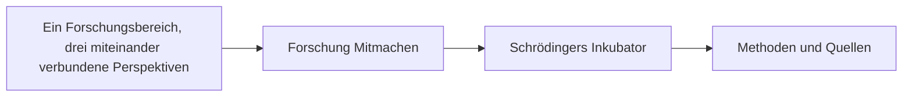

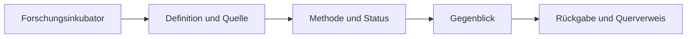

## [Eine Geo-KI, die mit der Wissenschaft sprechen kann](./interoperabilitaet.html)
**Anker:** Eine Geo-KI, die mit der Wissenschaft sprechen kann · Acht Forschungsfamilien · Vom Forschungsmodell zum ausführbaren Skill · Welche Formate fehlen dir? · SOULution · Forschungsanschluss · Gleiche Schnittstelle bedeutet nicht gleiches Fachmodell

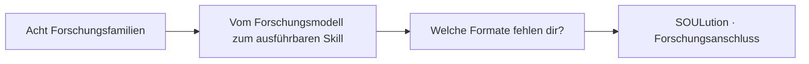

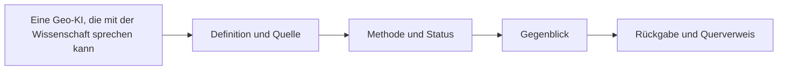

## [Wie wurde aus Rechenregeln die heutige KI – und welchen anderen Weg erfo](./ki-geschichte.html)
**Anker:** Wie wurde aus Rechenregeln die heutige KI – und welchen anderen Weg erfo · Die Spannungen, die unser Forschungsprojekt tatsächlich untersucht · 1 · Formale Gültigkeit oder plausible Antwort? · 2 · Explizites Wissen oder Lernen aus Beispielen? · 3 · Einzelne Skills oder tatsächlich nützliche Komposition? · 4 · Statische Struktur oder Prozess und Rückkopplung? · 5 · Datenmenge oder bestätigte Erkenntnis? · 6 · Offene Kooperation oder unprüfbare Blackbox?

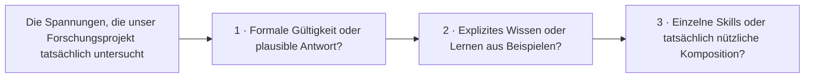

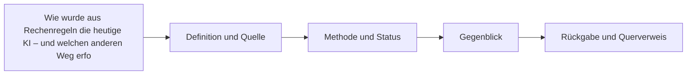

## [Kann aus klaren Skills eine KI entstehen?](./ki-kernforschung.html)
**Anker:** Kann aus klaren Skills eine KI entstehen? · 1. Nicht alles, was eine Aufgabe löst, ist schon eine KI · Funktion · Skill · Agent · Modell · Was müsste eine KI gegenüber einem gewöhnlichen Programm zusätzlich könn · 2. Die Entwicklung der KI: mehrere Wege statt eine zwangsläufige Linie

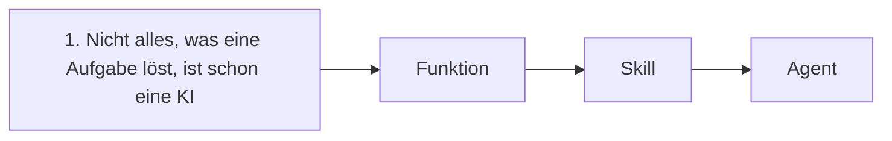

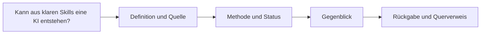

## [KI verstehen, Fähigkeiten verbinden, Ergebnisse prüfen](./ki-systeme.html)
**Anker:** KI verstehen, Fähigkeiten verbinden, Ergebnisse prüfen · Was ist KI – und was untersuchen wir? · ⚙ Symbolische KI · ◎ Statistische und neuronale KI · ◇ Agenten und hybride Systeme · Welche Ideen wurden kombiniert – und welche Spannungen bleiben? · 1940–1970 · Formale Grundlagen · 1980–2010 · Lernen und Suche

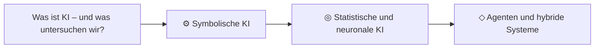

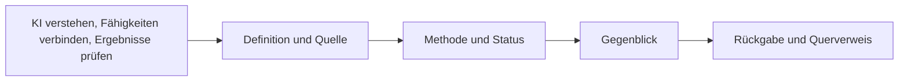

## [Aus wenigen Regeln möglichst viel zuverlässig rekonstruieren](./komprimierung.html)
**Anker:** Aus wenigen Regeln möglichst viel zuverlässig rekonstruieren · Aus einem Punkt und Winkeln ganze Formfamilien erzeugen · Komprimierung hat mehrere, nicht austauschbare Qualitätsbegriffe · Exakt rekonstruierbar · Definiert angenähert · Strukturell erklärend · Regeln müssen kompatibel sein, bevor wir sie kombinieren · Geometrie

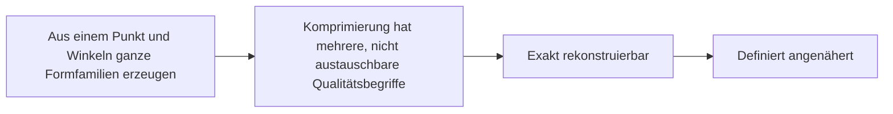

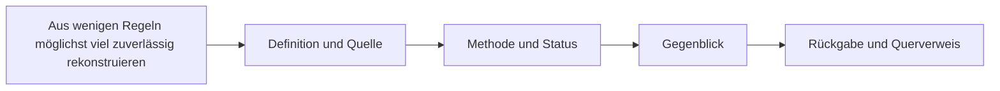

## [Bildbibliothek und Diagrammvorlagen](./medien.html)
**Anker:** Bildbibliothek und Diagrammvorlagen · Relationale Wortmarke · Tensorwürfel · Geo-KI Formen · Tensorprüfung · Geo-KI Prüfablauf · Designsystem für alle Fachbereiche · Tensor · Relationale Modellräume

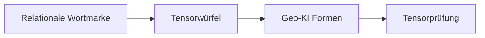

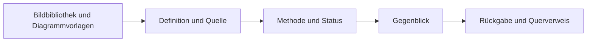

## [Die Minimal-KI: vom Operator zum ausführbaren System](./minimal-ki.html)
**Anker:** Die Minimal-KI: vom Operator zum ausführbaren System · 1. Eine einzelne Fähigkeit verstehen · 2. Vier Kernfunktionen · Gedächtnis · Regelverdichtung · Komposition · Rückkopplung · 3. Geo-KI – der erste anschauliche Schlüssel

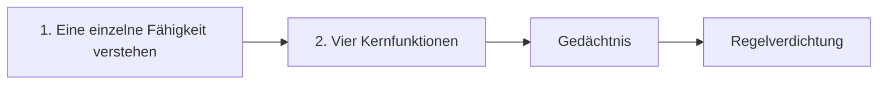

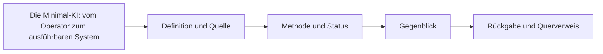

## [Forschungsbeitrag nachvollziehbar vorbereiten](./mitmachen-rueckgabe.html)
**Anker:** Forschungsbeitrag nachvollziehbar vorbereiten · Vor dem Weitergeben prüfen · Ergebnisakte · Ergebnis weitergeben

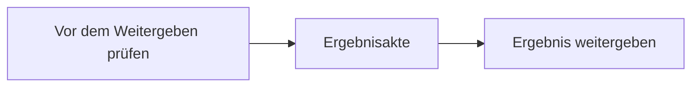

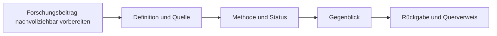

## [Entdecke, erweitere und verknüpfe den Tensor!](./mitmachen.html)
**Anker:** Entdecke, erweitere und verknüpfe den Tensor! · Von der eigenen Frage zum wissenschaftlichen Tensor · Didaktik: vom Allgemeinen zum Fachlichen · Ergebnisse weitergeben – auch ohne Git-Schreibrechte · So wird aus einer Idee ein überprüfbarer Beitrag · Finde deine Forschungsaufgabe · Harvesting: Wissenschaft systematisch erschließen · Aus Daten werden Bilder – und neue Forschungsfragen

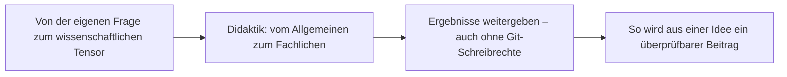

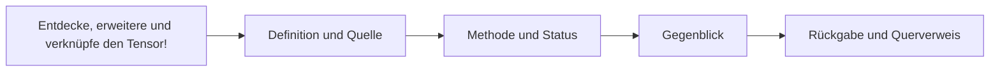

## [Was ist tatsächlich erledigt – und was bringt uns am meisten weiter?](./projektmanagement.html)
**Anker:** Was ist tatsächlich erledigt – und was bringt uns am meisten weiter? · Arbeitsstand im Überblick · Was ist als Nächstes dran? · Von der Promptidee zum geprüften Mitmachauftrag · Alle Forschungslinien nach Nachbereitungsbedarf · Welche Schritte wirken auf welche Forschungsfelder? · Aufgaben mit besonders vielen direkten Anschlussaufgaben · Betroffene Felder und Projekte

```mermaid
flowchart LR
P0["Arbeitsstand im Überblick"]
P1["Was ist als Nächstes dran?"]
P2["Von der Promptidee zum geprüften Mitmachauftrag"]
P3["Alle Forschungslinien nach Nachbereitungsbedarf"]
P0 --> P1
P1 --> P2
P2 --> P3
```

```mermaid
flowchart LR
A["Was ist tatsächlich erledigt – und was bringt uns am meisten weiter?"] --> B["Definition und Quelle"] --> C["Methode und Status"] --> D["Gegenblick"] --> E["Rückgabe und Querverweis"]
```

## [Wo bringt die nächste Nachbereitung am meisten?](./projektportfolio.html)
**Anker:** Wo bringt die nächste Nachbereitung am meisten? · Projektfelder vergleichen · Wie werden Projekte zur Abnahme vorbereitet?

```mermaid
flowchart LR
P0["Projektfelder vergleichen"]
P1["Wie werden Projekte zur Abnahme vorbereitet?"]
P0 --> P1
```

```mermaid
flowchart LR
A["Wo bringt die nächste Nachbereitung am meisten?"] --> B["Definition und Quelle"] --> C["Methode und Status"] --> D["Gegenblick"] --> E["Rückgabe und Querverweis"]
```

## [Vier Kernprojekte – eine gemeinsame Forschungsinfrastruktur](./projektstand.html)
**Anker:** Vier Kernprojekte – eine gemeinsame Forschungsinfrastruktur · Mini-KI · Komprimierung · Visuelle Engine · Geo-KI · Portfolio – welche nächsten Schritte wirken auf mehrere Projekte? · Abhängigkeiten sichtbar · Nachweise statt Scheinfertigstellung

```mermaid
flowchart LR
P0["Mini-KI"]
P1["Komprimierung"]
P2["Visuelle Engine"]
P3["Geo-KI"]
P0 --> P1
P1 --> P2
P2 --> P3
```

```mermaid
flowchart LR
A["Vier Kernprojekte – eine gemeinsame Forschungsinfrastruktur"] --> B["Definition und Quelle"] --> C["Methode und Status"] --> D["Gegenblick"] --> E["Rückgabe und Querverweis"]
```

## [Wissen finden, prüfen und weiterentwickeln](./publikationen.html)
**Anker:** Wissen finden, prüfen und weiterentwickeln · Bücher, Grundlagenwerke und Forschungspaper · Tensor · Grundlagen · KI-Systeme und Lernfähigkeit · SOULution und Forschung · Geo-KI und Wissenschaftsgrafik · Interoperabilität und Skills · Schrödingers Inkubator

```mermaid
flowchart LR
P0["Bücher, Grundlagenwerke und Forschungspaper"]
P1["Tensor · Grundlagen"]
P2["KI-Systeme und Lernfähigkeit"]
P3["SOULution und Forschung"]
P0 --> P1
P1 --> P2
P2 --> P3
```

```mermaid
flowchart LR
A["Wissen finden, prüfen und weiterentwickeln"] --> B["Definition und Quelle"] --> C["Methode und Status"] --> D["Gegenblick"] --> E["Rückgabe und Querverweis"]
```

## [Quellen und KI-Übergabe](./quellen-und-uebergabe.html)
**Anker:** Quellen und KI-Übergabe · Pflichtunterlagen · Eigenes Forschungsmanuskript · Taskregister · 99 Beobachterrollen · Weitere verifizierbare Projektgrundlagen · Aufgabenspezifische Quellen · OBS – Beobachter

```mermaid
flowchart LR
P0["Pflichtunterlagen"]
P1["Eigenes Forschungsmanuskript"]
P2["Taskregister"]
P3["99 Beobachterrollen"]
P0 --> P1
P1 --> P2
P2 --> P3
```

```mermaid
flowchart LR
A["Quellen und KI-Übergabe"] --> B["Definition und Quelle"] --> C["Methode und Status"] --> D["Gegenblick"] --> E["Rückgabe und Querverweis"]
```

## [Sitemap: Forschungsbereiche, Apps und Wissenswege](./sitemap.html)
**Anker:** Sitemap: Forschungsbereiche, Apps und Wissenswege

```mermaid
flowchart LR
P0["Anliegen"]
P1["Quellen"]
P2["Ergebnis"]
P0 --> P1
P1 --> P2
```

```mermaid
flowchart LR
A["Sitemap: Forschungsbereiche, Apps und Wissenswege"] --> B["Definition und Quelle"] --> C["Methode und Status"] --> D["Gegenblick"] --> E["Rückgabe und Querverweis"]
```
