<!-- BKI-MINIMAL-PAPER-V1 -->


**Forschungsedition · Stand 5. November 2026**  
**Kurzbeschreibung:** Mermaid-Seitengrammatik IV · SOULution, Tensor und fachliche Weiterwege – methodischer Bestand und Prüfstatus.  
**Schlagwörter:** Bürger-KI · Quellen · Evidenz · Tests · Mermaid-Seitengrammatik IV  
**Kontakt:** Kontakt@erlebNils.de

---

# Mermaid-Seitengrammatik IV · SOULution, Tensor und fachliche Weiterwege
**Vorlagen aus Seitengliederung. Nicht jeder Fachbereich braucht identische didaktische Reihenfolge.**
## [Was können wir gemeinsam nutzen, statt es erneut zu entwickeln?](./soulution-inkubator-quellen.html)
**Anker:** Was können wir gemeinsam nutzen, statt es erneut zu entwickeln? · Projektvergleich und Forschungsfelder · Wie das Register Teil unserer Infrastruktur wird

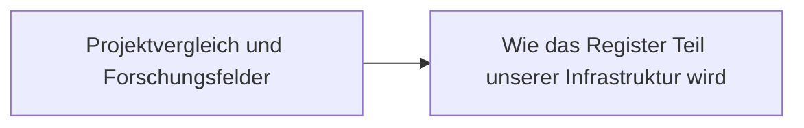

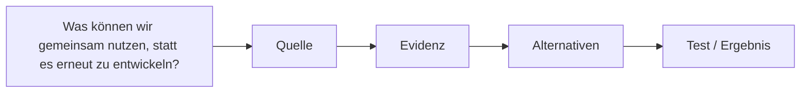

## [Wessen Stimme, wessen Musik, wessen Wissen?](./soulution-ki-kreativrechte.html)
**Anker:** Wessen Stimme, wessen Musik, wessen Wissen? · 1. Was müssen wir begrifflich auseinanderhalten? · Werk und Urheberrecht · Darstellung und Leistungsschutz · Stimme und Persönlichkeit · Training und Ausgabe · 2. Organisationen, Ansätze und belegte Aktivitäten · VDS · Verband Deutscher Sprecher:innen

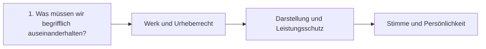

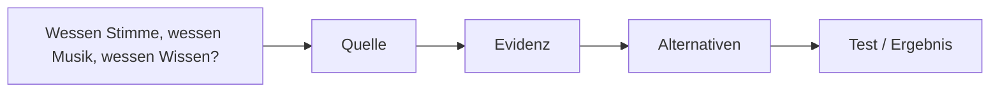

## [Eine Lösung kann bekannt sein – und trotzdem unerreichbar bleiben.](./soulution-potenzialarchitekturen.html)
**Anker:** Eine Lösung kann bekannt sein – und trotzdem unerreichbar bleiben. · Öffentliches Potenzial · Mediale Potenziale · 1 · Öffentliches Potenzial: Was muss tatsächlich möglich werden? · 2 · Mediale Potenziale: Auf welcher Ebene verliert eine Lösung ihre Wirk · 3 · Praxistest: Corona als gemeinsamer Wirkungsweg · 4 · Der noch offene große Potenzialtest: Arbeit, Probleme und Finanzieru · Was muss ein Problemregister enthalten?

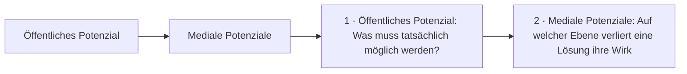

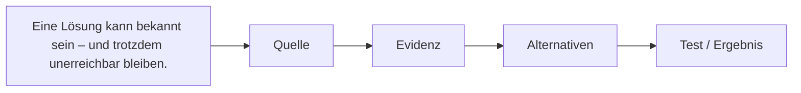

## [Schrödinger’s Inkubator: gemeinsam die Grundbausteine unserer digitalen ](./soulution-schroedingers-inkubator.html)
**Anker:** Schrödinger’s Inkubator: gemeinsam die Grundbausteine unserer digitalen  · Kernpaper · Digitale Souveränität und modulare Software · 1. Vom Wunsch zur kooperativen Infrastruktur · 2. Grundbausteine und praktische Funktionen · Identität & Nutzerverwaltung · Hosting & Dateien · Kommunikation · ERP / CRM / POS

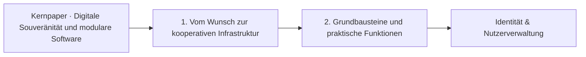

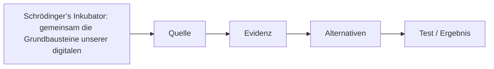

## [Was ist das Weltwissen wert – und wem kommt seine Nutzung zugute?](./soulution-weltwissen-dividende.html)
**Anker:** Was ist das Weltwissen wert – und wem kommt seine Nutzung zugute? · 1. Drei verschiedene Rechts- und Wertfragen · Gemeinsames Wissen · Kreative Leistung · Persönliche Identität · 2. Bild, Stimme und digitale Persona: internationale Ansätze · 3. Wissen bewahren oder vernichten? · 4. Was ist das Weltwissen eigentlich wert?

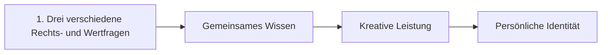

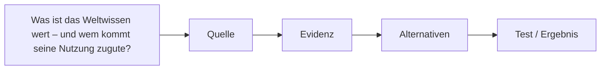

## [Wissen verbinden. Lösungen möglich machen.](./soulution.html)
**Anker:** Wissen verbinden. Lösungen möglich machen. · Was ist SOULution? · Neun vernetzte Forschungs- und Lösungsbereiche · Wie SOULution und KI-Tensor zusammenarbeiten · KI-Tensor · Modelle und Beziehungen · SOULution · Orientierung und Handlung · Verbundene Forschungswerkzeuge · SOULution – Forschungsbestände und Publikationen

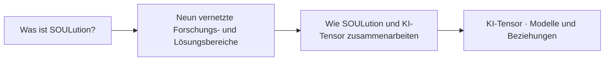

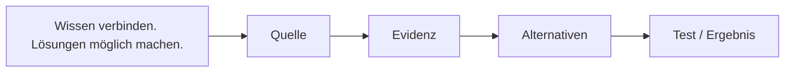

## [18 Taskkarten für die Skill- und Beobachterentwicklung](./taskkarten.html)
**Anker:** 18 Taskkarten für die Skill- und Beobachterentwicklung

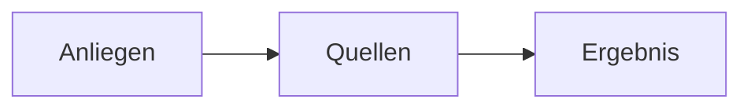

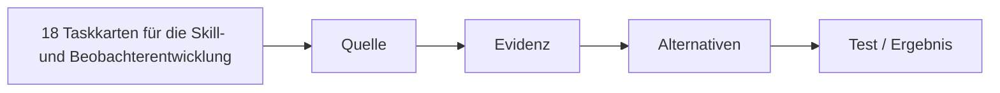

## [Was ist ein Tensor – und was erforschen wir damit?](./tensor-einfuehrung.html)
**Anker:** Was ist ein Tensor – und was erforschen wir damit? · 1. Von Beziehungen zum mathematischen Tensor · Skalar · Vektor · Matrix und lineare Abbildung · Tensor · 2. Ein einfaches Beispiel zum Nachrechnen · Erste Darstellung

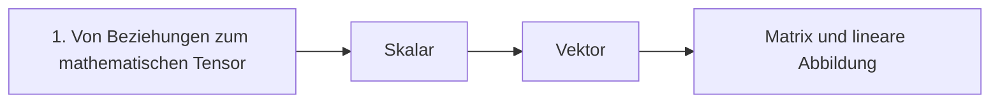

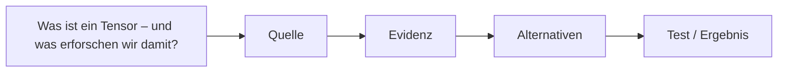

## [Das Besondere am Tensor: Drei Kerntrinitäten, ein relationaler Raum](./tensor-paper.html)
**Anker:** Das Besondere am Tensor: Drei Kerntrinitäten, ein relationaler Raum · Null-Matrix · Rel0 · Zyklus-Matrix · Rel-Rel · Einheits-Matrix · Rel1 · Was hat sich seit dem Original entwickelt? · Was die drei Matrizen erklären – und was erst zu prüfen ist · Historische Ordnung · Schlussvollzug

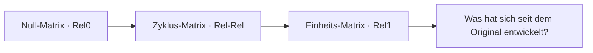

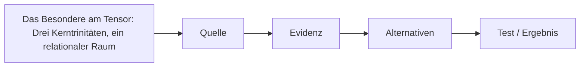

## [Wie werden wissenschaftliche Relationen zu Tensoren?](./tensoralgebra.html)
**Anker:** Wie werden wissenschaftliche Relationen zu Tensoren? · 1. Was bedeutet 3×3×3? · 2. Von der Quelle bis zum prüfbaren Ergebnis · 3. Sechs Referenzwissenschaften · Logik · Lineare Algebra · Geometrie · Graphentheorie

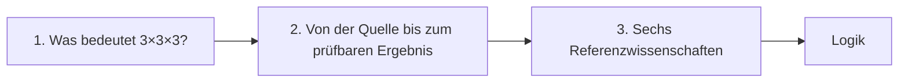

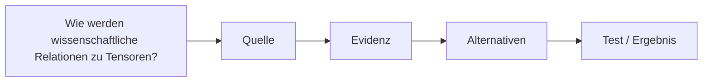

## [Was behauptet das Forschungsprojekt – und wie lässt sich das überprüfen?](./thesen.html)
**Anker:** Was behauptet das Forschungsprojekt – und wie lässt sich das überprüfen? · Was ist eine überprüfbare These? · Aussage · Gegenhypothese · Nachweis · Zentrale Forschungslinien · 1. Sind relationale Dreierstrukturen mehr als eine Klassifikation? · 2. Kann der Logik-Tensor zu einer relationalen Meta-Logik führen?

```mermaid
flowchart LR
P0["Was ist eine überprüfbare These?"]
P1["Aussage"]
P2["Gegenhypothese"]
P3["Nachweis"]
P0 --> P1
P1 --> P2
P2 --> P3
```

```mermaid
flowchart LR
A["Was behauptet das Forschungsprojekt – und wie lässt sich das überprüfen?"] --> B["Quelle"] --> C["Evidenz"] --> D["Alternativen"] --> E["Test / Ergebnis"]
```

## [Braucht KI eine kritische Masse vernetzter Wissenseinheiten?](./vernetzung-ki.html)
**Anker:** Braucht KI eine kritische Masse vernetzter Wissenseinheiten? · Ein Experiment als Anregung, nicht als KI-Beweis · Unsere überprüfbare Hypothese · Was muss konstant bleiben? · Versuchsdesign · Verbindung zu den vorhandenen Projekten · Mitmachprojekt · KI-Kollegen · Vernetzungshypothese

```mermaid
flowchart LR
P0["Ein Experiment als Anregung, nicht als KI-Beweis"]
P1["Unsere überprüfbare Hypothese"]
P2["Was muss konstant bleiben?"]
P3["Versuchsdesign"]
P0 --> P1
P1 --> P2
P2 --> P3
```

```mermaid
flowchart LR
A["Braucht KI eine kritische Masse vernetzter Wissenseinheiten?"] --> B["Quelle"] --> C["Evidenz"] --> D["Alternativen"] --> E["Test / Ergebnis"]
```

## [Wissenschaftliche Beziehungen sichtbar und überprüfbar machen](./visuelle-engine.html)
**Anker:** Wissenschaftliche Beziehungen sichtbar und überprüfbar machen · Drei Darstellungen – drei unterschiedliche Fragen · Strukturdiagramm · Prozessdiagramm · Prüfdiagramm · Eine Formel, eine sichtbare Änderung, eine Gegenprobe · Jede Grafik braucht Daten, Bedeutung und eine überprüfbare Quelle · Gemeinsame Icons und Fachfarben

```mermaid
flowchart LR
P0["Drei Darstellungen – drei unterschiedliche Fragen"]
P1["Strukturdiagramm"]
P2["Prozessdiagramm"]
P3["Prüfdiagramm"]
P0 --> P1
P1 --> P2
P2 --> P3
```

```mermaid
flowchart LR
A["Wissenschaftliche Beziehungen sichtbar und überprüfbar machen"] --> B["Quelle"] --> C["Evidenz"] --> D["Alternativen"] --> E["Test / Ergebnis"]
```

## [Wissen, Macht und Wirklichkeit](./wissen-macht-wirklichkeit.html)
**Anker:** Wissen, Macht und Wirklichkeit · Vier vorhandene Werke begleiten die Forschung · Wirtschafts-Simulationen und andere Mafia-Spiele · MACHT WISSENSCHAFT POLITIK – Evidente Evidenz · Öffentliches Potenzial · Mediale Potenziale · Eine Bürgerfrage: Was geschieht mit 500 Milliarden Euro? · SVIK · Sondervermögen Infrastruktur und Klimaneutralität

```mermaid
flowchart LR
P0["Vier vorhandene Werke begleiten die Forschung"]
P1["Wirtschafts-Simulationen und andere Mafia-Spiele"]
P2["MACHT WISSENSCHAFT POLITIK – Evidente Evidenz"]
P3["Öffentliches Potenzial"]
P0 --> P1
P1 --> P2
P2 --> P3
```

```mermaid
flowchart LR
A["Wissen, Macht und Wirklichkeit"] --> B["Quelle"] --> C["Evidenz"] --> D["Alternativen"] --> E["Test / Ergebnis"]
```


---

*Bürger-KI · Rechte verstehen. Probleme lösen. Gesellschaft verbessern.* · [Bürger-KI](./buerger-ki.html) · [Publikationen](./publikationen.html) · Kontakt@erlebNils.de · 05.11.2026
