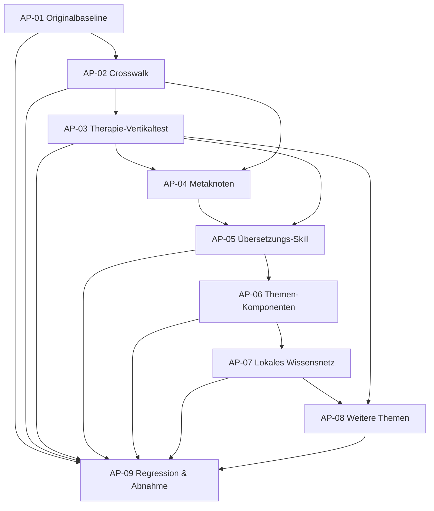

# Bürger-KI – Architekturprogramm für Lernwelten, Crosswalk und Übersetzungs-Skills
## Technischer und redaktioneller Umsetzungsplan · v1.0

**Plan-ID:** BKI-ARCH-2026-11-05-001  
**Stand:** 2026-11-05 · **Status:** verbindlicher *Planentwurf*, Umsetzung der neun Pakete nicht behauptet  
**Repository:** `Memnosis/relationalitaet`, Branch `main`  
**Referenz-Baseline:** Git-Tree `e376901b581e404b142248feeed45624d3eba289` vor diesem Plan  
**Verknüpfte Phase:** [Phase 15](../../docs/buerger-ki-phase-15-sprache-uebersetzung-no-loss.md) · [Originalsprach-Audit](../../docs/paper-buerger-ki-originalsprache-claims-didaktik-no-loss-v0-1.md) · [Sprachräume-Paper](../../docs/paper-buerger-ki-sprachraeume-termini-operationalisierung-claims-v0-1.md)

> **Vorrangentscheidung 05.11.2026 – Sprache vor User Storys:** Vor dem breiten Seitenumbau und dem User-Story-Test zunächst alle fünf Lernwege sprachlich und fachlich ausformulieren, die Bedeutungsübersetzungen auf Ebene der Elemente und Spiegelungen prüfen und jeden geplanten aufklappbaren Wissensraum mit hinreichendem Inhalt, Quellen und Rückweg belegen. Siehe [Sprachprojekt](./SPRACHPROJEKT_PFADGRAMMATIK_UEBERSETZBARKEIT_WISSENSRAEUME_V1_2026-11-05.md), [Pfadelementinventar](./SPRACHPFADE_ELEMENTINVENTAR_V0_1.json) und [Redaktionsfassung aller fünf Lernwege](./SPRACHPFADE_REDAKTIONELLE_FASSUNG_V0_1_2026-11-05.md). Der Crosswalk kann als vorbereitender semantischer Rahmen parallel entstehen; Komponenten-/User-Story-Rollout ist bis zur Sprachanalyse-Gate-Abnahme zurückgestellt.\n\n## 0. Architekturbeschluss und Arbeitsgrenzen

Die Bürger-KI **entwickelt allgemeine, prüfbare KI-Fähigkeiten für menschliche Anliegen**, keine zentrale Datenbank persönlicher Bürgerfälle. Alle Lernbeispiele sollen anhand öffentlicher Fachquellen oder ausdrücklich synthetischer Beispiele entstehen. Es gibt kein implizites Versprechen auf Rechtsdurchsetzung, einen verfügbaren Therapieplatz oder funktionierende Software, solange dies nicht nachgewiesen ist.

**Drei Ebenen:** (1) menschliche Erzählung und freiwillige Lernwege; (2) fokussierte, querverlinkte Themenwelten mit Meta-Knoten; (3) kanonische Forschungsobjekte und Beweis-/Testakten. Ein Thema kann zu einer möglichen Lösung, zu Schadensbegrenzung, einer wissenschaftlichen Einsicht oder einer unauflösbaren/nicht ausreichend belegten Grenze führen. Rückwege sind sinnvoll, wenn der Erkenntniszuwachs sichtbar ist.

**Redaktionsregel:** Historische Headlines und 21 ursprüngliche Anker nicht heimlich überschreiben. Die 28 neuen Vorschläge sind keine freigegebenen Fachbehauptungen. Ein starker Claim gehört an den Erkenntnissprung, nicht zwischen alle Quellen. Bei Übersetzungen immer Ausgangsbedeutung, erhaltene Bedingungen und Risiken zeigen.

**Architekturregel:** Keine zusätzliche parallele Wahrheitsdatenbank. Originalregister bleiben kanonische Eigentümer; Crosswalk und UI-Indizes speichern Referenzen, Sinnbeziehungen, Kontext und Review, aber nicht ungeprüft duplizierte Fachbehauptungen.

## 1. Bestandsabgleich (tatsächlich geprüft)

| Bestand | Aktueller Fundort | Struktur / gesicherter Befund |
| --- | --- | --- |
| Hauptseite | `docs/buerger-ki.html` | historische Story, Hero, Fachkacheln, Forschungsverweise; Originalsprachen-Audit referenziert 64 erhaltene historische H1–H3 |
| Historische Claims | `docs/data/bki-redaktionelle-anker-claims-v0-1.json` | 21 IDs `BKI-CLAIM-...`, redaktionell geschützt |
| Neue Claims | `docs/data/bki-sprachraeume-claims-v0-1.json` | 28 IDs `BKI-LC-...`, nicht freigegeben |
| Wissenschaftlicher Claim-Vertrag | `forschung/register/schema/claim.schema.json` | `CLM-...`, `SRC-...`, getrennte Evidenz-, Quellen- und Redaktionsstatus |
| Lernweg-Orchestrierung | `docs/data/bki-lernpfade-orchestrierung-v0-1.json` | 5 `entry-...`, 5 `LP-...`, 6 Fachfilter, 12 modellierte Objektarten |
| Therapieplatz | `docs/data/bki-therapieplatz-fuenf-blickwinkel-v0-1.json` | `BKI-TOPIC-THERAPY`, Linsen `ziel`, `wissen`, `hilfe`, `gesellschaft`, `forschung`, plus 5 Spiegelungen |
| Ziellexikon | `docs/data/bki-ziele-lexikon-kernel-v0-1.json` | 12 `BKI-C001..012`, 8 `BKI-G001..008`, 7 bislang nicht durchgehend einzeln ID-tragende Relationen, 6 `BKI-ZHA-T...` |
| Glossar | `docs/data/glossar-kern.json` | 12 Web-Kurzdefinitionen; historischer 1.072-Einträge-Bestand wird referenziert, ist nicht darin importiert |
| Forschungsbibliothek | `docs/data/bki-forschungsbibliothek-v0-1.json` | 22 kuratierte Einträge, ausdrücklich **kein** Gesamtinventar |
| Tests | `.github/workflows/website-preflight.yml`, `.github/workflows/website-browser-smoke.yml`, `forschung/buerger-ki/test_bki_gii_adapter.py` | bestehende P0-/Chromium-Sicherung und synthetische Fachtests, kein vollständiger Beweis der neuen Architektur |

**Bestandsgrenze:** Dies ist eine gezielte Prüfung der genannten Dateien und des Repository-Baums, kein lückenloser Quellen-/Rechts- oder Browseraudit. Der historische ZIP-Gesamtstand wurde hier nicht importiert.

## 2. Objektvertrag: Wer besitzt welche Wahrheit?

| Typ / ID-Namensraum | Kanonischer Ort / Eigentümer | Referenz in Themenwelt |
| --- | --- | --- |
| Fachquelle / Originalfassung `SRC-...` oder bereits existierende Original-ID | gemeinsames Quellenregister, Originaldokument/versionierter Beleg | `source_ref`, Fundstelle, Rolle und Prüfstatus |
| Konzept `BKI-C...` / Glossar-Sinn-ID | Zielelexikon bzw. gemeinsames Glossar; keine künstliche Zusammenlegung | `concept_ref`, `sense_scope` |
| Ziel `BKI-G...` | Zieleatlas | `goal_ref`, Erfolgskriterium |
| Historischer Redaktionsanker `BKI-CLAIM-...` | historisches Claim-Register | `editorial_ref`, Rolle und zugelassener Kontext |
| Neue Headline `BKI-LC-...` | vorgeschlagene Claim-Sammlung | `editorial_ref`, Status `proposed` |
| Wissenschaftliche Aussage `CLM-...` | wissenschaftliches Claim-Register nach bestehendem Schema | `claim_ref`, Quellenstatus/Evidenz/Freigabe |
| Sprachraumhypothese `LANG-T...` | bestehendes Paper, später Thesen-Index | `hypothesis_ref`, `unassessed` |
| Lernweg `LP-01..05`, Einstieg `entry-...` | Lernweg-Orchestrierungsregister | `lens_ref` |
| Kernthema `BKI-TOPIC-THERAPY` | Themenregister, derzeit Therapie-Pilot | `topic_ref` |
| Neuer Metaknoten `BKI-META-001` ff. | neues Meta-Register (geplant) | `meta_ref`, abstrahierte Frage, keine voreilige Ursachenidentität |
| Neue Crosswalk-Kante `BKI-XW-0001` ff. | neue Kantenliste (geplant) | Relation, Geltung, Provenienz, Prüfstatus |
| Neue Übersetzungsprobe `BKI-TR-0001` ff. | Übersetzungs-Testregister (geplant) | Eingabe, Sinnprüfung, Vorwärts-/Rückprüfung |
| Skill `BKI-SK-TRANSLATE-001` (reserviert) | bestehende Skillbibliothek + neue Spezifikation | `skill_ref` mit Test- und Reifegrad |
| Test `BKI-TEST-...` | projektspezifisches Testregister | `test_ref`, Ergebnis, Gegenbeispiel |

**ID-Sicherheitsregeln:** Bestehende IDs unverändert weiterverwenden. `CLM` und `BKI-CLAIM` dürfen nicht automatisch synonymisiert werden. Für Crosswalk-Kanten und Übersetzungen neue, eindeutig reservierte Bereiche nutzen. Vor Implementierung bestehende Kollisionen prüfen; menschenlesbare Aliasse dürfen niemals still den kanonischen Schlüssel ersetzen. Relationen aus alten Dateien ohne Einzel-ID über `legacy_record_pointer` + Quellhash referenzieren, erst nach Deduplikation dauerhafte Relation-IDs vergeben.

## 3. Crosswalk- und No-Loss-Vertrag

### 3.1 Standardkante (Entwurf)

```json
{
  "edge_id": "BKI-XW-0001",
  "from": {"namespace": "bki-editorial", "id": "BKI-CLAIM-02"},
  "to": {"namespace": "bki-concept", "id": "BKI-C002"},
  "relation": "illustrates",
  "scope": {"language": "de", "jurisdiction": "DE", "valid_at": null},
  "provenance": {"repository_path": "docs/data/bki-redaktionelle-anker-claims-v0-1.json", "source_ids": []},
  "equivalence": "not_claimed",
  "evidence_status": "unassessed",
  "review_status": "proposed",
  "version": "0.1"
}
```

**Wichtig:** Beispiel ist nur ein vorgeschlagener illustrativer Link, kein bestätigter Beweis und keine Behauptung, dass Begriffe synonym sind.

### 3.2 Erlaubte Kanten

`illustrates`, `defines`, `expresses`, `supports`, `contradicts`, `operationalizes`, `tested_by`, `depends_on`, `offers_alternative`, `mitigates_risk`, `raises_meta_question`, `perspective_of`, `has_source`, `navigates_to`, `supersedes`, `related_but_not_equivalent`.

Auf der Website erscheinen zunächst nur sechs menschenlesbare Linktypen: **Vertiefen**, **Anwenden**, **Spiegeln**, **Gegenprüfen**, **Verbinden**, **Zurückführen**. Eine wissenschaftliche Relation ist nicht notwendigerweise ein navigationsfähiger Link; der Adapter wählt nach Kontext und Leserfrage.

### 3.3 Pflichtprüfung jedes Änderungsevents

`Quelle → Konzept/Sinn → These/Claim → Operationalisierung → Test/Gegenfall → Ergebnis → Skill → Lernmodul → öffentlicher Claim → Publikation`.

Für jeden Eingriff: (1) eindeutiger Ausgangsstand/Hash, (2) erkannte abhängige IDs, (3) behaltene und neue Informationen, (4) Reviewzustand, (5) betroffene Links, (6) ausdrücklich bewahrte Negativbefunde, (7) Diff mit eventuellen Brüchen. `missing`, `conflicted`, `unassessed` sind legitime Ergebnisse. Kein grüner Status allein wegen eines formal gültigen JSONs.

## 4. Neun Arbeitspakete mit genauer Durchführung

### AP-01 · Originalgeschichte und Claims als Baseline sichern
**ID:** `BKI-AP-01` · **Priorität:** P0 · **Vorgänger:** keine

**Eingaben:** historische Git-Fassung `873efa035e940fa727568886dd7c510cfd5115f1`, aktuelles `docs/buerger-ki.html`, Originalsprach-Paper, 21 redaktionelle Anker und 28 neue Entwürfe.

**Anlegen:**
- `forschung/buerger-ki/baselines/bki-original-2026-11-05.json` – historische Commitreferenz, geordnete `h1..h3`-Normtextliste, Satzfundstellen, Links, Checksummen und Redaktionsstatus.
- `forschung/buerger-ki/tests/test_editorial_baseline.py` – prüft 21 historische Claim-Texte, Identität, eindeutige IDs und dass alle 64 historischen Headline-Anker aus der Referenz bewahrt oder explizit als redaktionelle Änderung genehmigt sind.
- `forschung/buerger-ki/BKI_EDITORIAL_CHANGES.md` – begründete Änderungsvorschläge getrennt vom Quelltext.

**Nicht ändern:** `docs/data/bki-redaktionelle-anker-claims-v0-1.json` und Hero der Hauptseite ohne Review. Alte Überschriften nicht allein wegen Platzierung identisch zählen: Reihenfolge und Sichtbarkeit getrennt testen.

**Redaktion:** Originalsprache als Markenanker, keine eigens erfundenen neuen Claims auf der Startseite.  
**Abnahme:** historische Referenz aus Git reproduzierbar, 21/21 Text-IDs exakt, 64 ursprüngliche Headlines aus Originalcommit maschinenprüfbar; unbewilligte Entfernung/Änderung führt zu Testfehler.

### AP-02 · Kanonische IDs und Crosswalk-Relationen
**ID:** `BKI-AP-02` · **Priorität:** P0 · **Vorgänger:** AP-01-Baseline als Vergleich

**Anlegen:**
- `forschung/buerger-ki/schema/bki-crosswalk.schema.json` – Endpunkttypen, 16 Relationen, Geltung, Evidenzstatus, Provenienz, Review, Version.
- `forschung/buerger-ki/register/bki-id-map-v0-1.json` – deklarierte Namensräume, Eigentümer, Legacy-Aliasse.
- `forschung/buerger-ki/register/bki-crosswalk-v0-1.json` – **zunächst wenige**, konkret belegbare und als Vorschlag markierte Kanten.
- `forschung/buerger-ki/bki_crosswalk.py` – Validator/Impact-Ermittlung; bestehende Eigentümerdateien bleiben read-only.
- `forschung/buerger-ki/tests/test_bki_crosswalk.py` – Referenz- und Negativtests.

**Testfälle:** dangling ID, unzulässiger Relationstyp, alias collision, Dopplung unter anderer Schreibweise, falsche `CLM`-Evidenzvergabe, Kante ohne Quellenrolle, `supersedes`-Zyklus, `related` fälschlich als Äquivalenz. Herkömmliche Navigationszyklen sind **erlaubt** und werden anders geprüft.

**Abnahme:** Alle neu angelegten Kanten bestehen JSON-Schema und Referenzauflösung; kein vorhandener Eigentümerdatensatz überschrieben; fehlende und unklare Ziele werden als Blocker ausgegeben statt still ergänzt.

### AP-03 · Therapieplatz-Vertikaltest über alle fünf Perspektiven
**ID:** `BKI-AP-03` · **Priorität:** P0 · **Vorgänger:** AP-02 (Schema) · **Bestehende ID:** `BKI-TOPIC-THERAPY`

**Bestehende Grundlage:** `docs/data/bki-therapieplatz-fuenf-blickwinkel-v0-1.json`, `docs/buerger-ki-blickwinkel-therapieplatz.html`, fachliche Versorgungs-/Bedarfspaper.

**Anlegen:**
- `forschung/buerger-ki/piloten/therapieplatz/vertical-case-v0-1.json` – kanonischer Referenzsatz mit fünf `lens_id`: `ziel`, `wissen`, `hilfe`, `gesellschaft`, `forschung`.
- `forschung/buerger-ki/piloten/therapieplatz/source-matrix-v0-1.json` – Quelle, konkreter Fund, Zeitraum, Rechts- und Regionalgeltung, Claimrolle, Abrufstatus.
- `forschung/buerger-ki/piloten/therapieplatz/negative-cases-v0-1.json` – z. B. Erstkontakt ≠ fortlaufende Behandlung; individuelle erfolglose Suche ≠ repräsentativer Nachweis struktureller Unterversorgung.
- `forschung/buerger-ki/tests/test_therapy_vertical.py`.

**Je Blickwinkel dieselben Pflichtfelder:** Ausgangsfrage, was bekannt ist, was offen ist, Begriffssinne, Quelle/Provenienz, notwendiger Nachweis, nächster möglicher Weg, Gegenbeispiel, Risiken/Schadensbegrenzung, Meta-Übergang, Rückweg.

**Fachgrenze:** keine medizinische Indikation durch KI, keine behauptete Kapazitätsabfrage, keine pauschale Kostenerstattung. Nur öffentlich nachvollziehbare fachliche Wege und Quellen.

**Abnahme:** fünf unterschiedliche, nachvollziehbare Perspektiven; jeder Pfad enthält eine einzigartige Erkenntnis oder zusätzliche Fragestellung und einen Rückweg; keine unbelegte strukturelle Behauptung; alle fachlichen Aussagen mit Fundstellen-/Statusakten.

### AP-04 · Metaknoten Ziel → Umsetzung → Wirkung → Schadensbegrenzung
**ID:** `BKI-AP-04` · **Priorität:** P0 · **Vorgänger:** AP-02, AP-03

**Anlegen:**
- `forschung/buerger-ki/schema/bki-meta-node.schema.json`.
- `forschung/buerger-ki/register/bki-meta-nodes-v0-1.json`.
- `forschung/buerger-ki/tests/test_meta_routes.py`.

**Erster Metaknoten:** `BKI-META-001` – *Wann wird aus einem vorgesehenen Angebot tatsächliche Zielerfüllung?*  
**Weitere Kandidaten (nicht als Befund):** `BKI-META-002` Zuständigkeit vs. Wirksamkeit; `BKI-META-003` Versorgung und Kapazität; `BKI-META-004` Messbarkeit und Definitionsgeschichte; `BKI-META-005` Schadensbegrenzung bei ausbleibender Lösung.

**Knotenform:** Leitfrage, auslösende Themen-IDs, Gemeinsamkeitstyp (`same_question`/`similar_pattern`/`shared_operator`/`shared_cause_confirmed`), explizite Unterschiede, mögliche Handlung, mögliche Minderung des Risikos, Belegstatus, Gegenfall, Rücklinks. `shared_cause_confirmed` nur mit eigenständiger Kausalprüfung.

**Kreisregel:** Der Rückweg zum Ursprung wird als Lernergebnis markiert: `new_insight`, `new_option`, `reframed_question` oder `no_new_information`. Letztere Schleifen werden redaktionell zusammengelegt oder verborgen, nie als Fortschritt verkauft.

**Abnahme:** Therapieplatz und ein zweites Thema können denselben Metaknoten mit ausdrücklich unterschiedlichen Rechts-/Fachbedingungen referenzieren; Navigation bietet Zurück zum Anliegen und Tiefer zur Systemfrage; kein falscher Kausalitätsschluss.

### AP-05 · Übersetzungs-Skill mit Rückübersetzung und Gegenproben
**ID:** `BKI-AP-05` · **Priorität:** P1 · **Vorgänger:** AP-02–04

**Anlegen:**
- `forschung/buerger-ki/skills/BKI_SK_TRANSLATE_001.md` – Ein-/Ausgaben, Nutzungsfälle, Fehlertaxonomie, Geltungsgrenzen, Skill-Reifegrad.
- `forschung/buerger-ki/schema/bki-translation.schema.json`.
- `forschung/buerger-ki/bki_translate.py` – initial deterministische Testschnittstelle und Prüfprotokoll (keine unvalidierte automatisierte Fachübersetzung).
- `forschung/buerger-ki/piloten/therapieplatz/translation-gold-v0-1.json`.
- `forschung/buerger-ki/tests/test_bki_translate.py`.

**Sechs Modi:** Lebenswelt→Fachfrage, Fachsprache→Klartext, Institution→Wirkung, Quelle→These/Test, Formalmodell→Lernweg, natürliche Sprache/Rechtsraum→anderer Sprach-/Rechtsraum.

**Ausgabe:** `original`, `target_text`, `mode`, `concept_senses`, `invariants`, `losses`, `new_assumptions`, `source_refs`, `uncertainty`, `reverse_translation`, `counterexample`, `review_status`. Rückübersetzung deckt mögliche Drifts auf, ist allein **kein** Nachweis semantischer Äquivalenz.

**Goldstandard zunächst:** zehn sorgfältig ausgewählte öffentliche/synthetische Beispiele, darunter echte Mehrdeutigkeiten, unterschiedliche Rechtsräume, Begriffsüberdehnungen und absichtlich fehlerhafte Übersetzungen. Fachreview erforderlich, bevor generierte Texte als geprüfte öffentliche Erklärung freigegeben werden.

**Abnahme:** alle 6 Modi verfügen über definierte Eingabe-/Ausgabeobjekte und mindestens einen positiven und negativen Test; Verlust und Unsicherheit werden sichtbar; absichtlich falsche Rechts- und Outcome-Gleichsetzungen werden zurückgewiesen. „Implementiert“ erst nach tatsächlich erfolgreichen automatisierten Tests, „fachlich geprüft“ erst nach geeignetem Review.

### AP-06 · Kernthemenseiten + sechs Linktypen als Komponenten
**ID:** `BKI-AP-06` · **Priorität:** P1 · **Vorgänger:** AP-02–05

**Anlegen:**
- `docs/assets/bki-topic-card.js` – wiederverwendbare Ausgabe aus registrierten, redaktionell freigegebenen Themenobjekten, Text aus `textContent` statt ungesicherter HTML-Injektion.
- `docs/assets/bki-topic-card.css` – Konsistenz mit `website-unified.css` und `buerger-ki-design.css`.
- `docs/data/bki-topic-navigation-v0-1.json` – Themen-ID, Anker, sichtbare Überschrift, Linktyp, Ziel, Kurzbegründung, Freigabestatus.
- `forschung/buerger-ki/tests/test_topic_navigation.py`.

**Sechs sichtbare Typen:** `deepen` (Vertiefen), `apply` (Anwenden), `mirror` (Spiegeln), `challenge` (Gegenprüfen), `connect` (Verbinden), `trace` (Zurückführen).

**Komponentenstruktur:** menschlicher Einstieg → eine verständliche Kernaussage → fünf Wahlperspektiven → die wichtigsten fachlichen Erkenntnisse → Optionen/Schadensbegrenzung/Grenzen → 2–4 sinnvoll priorisierte Links → optionaler Nachweis- und Netzraum. Keine Pflicht, alle Querverweise als Kacheln zu rendern.

**Integrationsorte:** vorhandene `docs/buerger-ki-blickwinkel-therapieplatz.html` als erstes Muster; `docs/buerger-ki-lernpfade.html` als Navigator; `docs/buerger-ki.html` behutsam als Ausgang und Rückweg. Die Startseite bleibt textlich geschützt. Kein globales Hauptmenü pro neuem Thema.

**Abnahme:** jeder Link hat Zweck/Label und korrektes Ziel, alle sechs Typen sind in der Testansicht nachweisbar; Rücknavigation/Anker funktionieren per Tastatur und mobil; Originalgeschichte bleibt unberührt.

### AP-07 · Lokales Wissensnetz als optionaler Deep Dive
**ID:** `BKI-AP-07` · **Priorität:** P2 · **Vorgänger:** AP-02, AP-04, AP-06

**Anlegen:**
- `docs/assets/bki-local-graph.js`, `docs/assets/bki-local-graph.css`.
- `docs/data/bki-graph-projection-v0-1.json` – *UI-Projektion* aus freigegebenen Kanten, keine neue Fachdatenbank.
- `forschung/buerger-ki/tests/test_graph_projection.py`; Browser-Prüfungen im bestehenden Playwright-Script.

**Design:** Keine Gesamtwolke aus Tausenden Knoten. Um aktuelles Kernthema zunächst 1 Hop, maximal einige wenige ausgewählte Nachbarn, Filter nach Frage/Linktyp; alle Infos zusätzlich als fokussierte Text-/Linkliste, wenn SVG/JS ausfällt. Zoom/Weiterblättern nur auf Nutzerwunsch. Quelle/Evidenzstatus beim Öffnen eines Knotens sichtbar. Reduzierte Bewegung und Tastaturbedienung.

**Abnahme:** UI-Netz reproduzierbar aus demselben Register generierbar, keine Quellen- oder Behauptungserfindungen, keine UI-Blocks bei großen Datenbeständen, Fallback-Liste vollständig bedienbar; mobil und bei `prefers-reduced-motion` nutzbar.

### AP-08 · Weitere Kernthemen aus echten Quellen übertragen
**ID:** `BKI-AP-08` · **Priorität:** P2 · **Vorgänger:** validiertes AP-03–07-Muster

**Kandidaten:** (a) bewilligte, aber nicht ausgezahlte Sozialleistung; (b) Schul-/Unterstützungsangebot; (c) Pflege/Versorgung; (d) Programmziel vs. gemessene Wirkung. Reihenfolge nach belegten Primärquellen, relevanter menschlicher Frage und echten Gegenbefunden festlegen, nicht nach Anzahl verfügbarer Kacheln.

**Anlegen je Thema:** `forschung/buerger-ki/piloten/<slug>/vertical-case-v0-1.json`, `source-matrix-v0-1.json`, `negative-cases-v0-1.json`, plus Eintrag in `docs/data/bki-topic-navigation-v0-1.json` nur nach Review.

**No-Loss-Transfer:** das Schema der fünf Perspektiven wiederverwenden, **nicht** medizinische, rechtliche oder statistische Aussagen vom Therapieplatz kopieren. Gleiche Metafrage ≠ gleiche Ursache. Ein Thema kann explizit nur drei oder vier sachlich ergiebige Perspektiven besitzen; alle fünf Navigationsmöglichkeiten bleiben, leere Sachinhalte werden nicht künstlich gefüllt.

**Abnahme:** mindestens zwei weitere Themen mit Primärquellen- und Gegenprobenverweisen, fachlich differenziertem Metaknoten und nachweislich keinen duplizierten kanonischen Begriffssätzen.

### AP-09 · Browser-, Quellen-, Link- und Verständnistests
**ID:** `BKI-AP-09` · **Priorität:** P0, parallel zu allen Paketen

**Bestehende Infrastruktur wiederverwenden:** `.github/workflows/website-preflight.yml`, `.github/workflows/website-browser-smoke.yml` und `scripts/verify_website_browser.mjs`. Ergänzungen nur mit klarer Kompatibilitäts- und Regressionsprüfung.

**Anlegen:**
- `forschung/buerger-ki/tests/test_bki_site_contracts.py` – interne URLs und Fragmentanker, vorliegende JSON-Files, ID-Integrität, thematische Rückwege.
- `forschung/buerger-ki/tests/test_bki_source_registry.py` – Quellen-IDs, Link-/Zugangsstatus, Fundstellen- und Rechtsraumgrenzen.
- `forschung/buerger-ki/tests/test_bki_noloss.py` – historische Textbaseline, Crosswalk-Auswirkungen, konservierte Negativbefunde.
- `forschung/buerger-ki/piloten/therapieplatz/usability-protocol-v0-1.md` – reale Aufgaben für Verständnistests; keine erfundenen Teilnehmer/Ergebnisse.
- `reports/bki-architecture/` – CI-Ergebnisberichte (GitHub Actions Artefakte, keine dauerhafte Fake-Ergebnisdatei).

**Prüfmatrix:** Desktop 1440px, Mobil 375px, Tastatur und Screenreader-Semantik, Zoom 200%, reduzierte Bewegung, deaktiviertes JavaScript, Such-/Quellenlinks, externe Linkfehler (nur als Access-Status, kein Beweis fehlender Quelle), Rückwege und Schleifen. Verständnistest: Leser können Problem, fachliche Grenze, nächsten Schritt und Meta-Frage unterscheiden.

**Abnahme:** alle strukturellen CI-Tests grün und dokumentiert; keine gebrochenen internen Links; keine verlorenen Original-Claims; keine unbewilligten Evidenz-/Freigabewechsel. Mobile und Verständlichkeitsabnahme nur bei tatsächlich durchgeführter Prüfung als erledigt markieren.

## 5. Abhängigkeitsplan



**Praktische Iteration:** Tests laufen von Beginn an; die fachliche Übersetzung kann parallel zum Metaknoten vorbereitet werden, aber Veröffentlichung/Integration erfordern jeweils die bestandenen Vorgänger-Gates. Das optionale Netz darf die Veröffentlichung einer guten, barrierearmen Themenseite nicht blockieren.

## 6. Verbindliche interne Linkmatrix

| Von | Wozu? | Linktyp | Ziel im Bestand |
| --- | --- | --- | --- |
| `buerger-ki.html` | geeigneten Weg wählen | `apply` | `buerger-ki-lernpfade.html` |
| `buerger-ki-lernpfade.html` | konkretes Beispiel erleben | `deepen` | `buerger-ki-blickwinkel-therapieplatz.html` |
| Therapieplatz – Ziel | Zielzustand zerlegen | `apply` | `buerger-ki-zielpfade.html` |
| Therapieplatz – Wissen | Begriffe differenzieren | `deepen` | `buerger-ki-ziele-lexikon.html` |
| Therapieplatz – Hilfe | Zuständigkeit und Wege prüfen | `apply` | `buerger-ki-weisungsatlas.html` (nur soweit fachlich einschlägig) |
| Therapieplatz – Gesellschaft | Versorgung und Messbarkeit kritisch betrachten | `mirror` | `buerger-ki-grundlagen.html` |
| Therapieplatz – Forschung | Quellen und Gegenprüfungen | `trace` | `buerger-ki-forschungsbibliothek.html` |
| Thema → Metafrage | systematisch ähnliche Frage entdecken | `connect` | neuer Metaknoten `BKI-META-001` (URL erst bei Implementierung) |
| These → Gegenbefund | Grenzen sichtbar machen | `challenge` | kanonische negative Test-/Ergebnisakte |
| Meta → Ursprungsanliegen | gelernt zurückkehren | `apply` | entsprechender Themenanker mit dokumentiertem Erkenntniszuwachs |
| Fachseite → Paper | volle Rekonstruktion prüfen | `trace` | passender Bibliothekseintrag `BKI-LIB-...` |

Die Matrix ist eine **Soll-Verlinkung**. Ein vorhandener Seitentitel ist kein Nachweis, dass dort bereits die komplette gewünschte fachliche Antwort steht.

## 7. Datendarstellung, Performance und Sicherheitsgrenzen

**Leseroberfläche:** prägnante menschliche Frage; wenige, semantisch eindeutige Links; vollständige Detailtiefe freiwillig. **Netzebene:** thematische 1-Hop-Projektionen statt Gesamtgraph. **Kanonische Speicherung:** vorhandene JSON-/Markdown-/Quellenregister, versioniert und mit Teststatus.

Keine Browseranfragen an externe APIs als Voraussetzung für die Kernnavigation. Öffentliches statisches GitHub Pages reicht für v1; ein späterer API-Dienst wird erst bei tatsächlich benötigten Funktionen geprüft. Keine persönlichen Fälle, Gesundheitsakten, Kontaktlisten Betroffener oder individueller Verlaufsdaten im Projektbestand. Graph-Labels werden vor Rendering escaped, externe Links mit klarer Herkunft und ohne stillen Kontexttransfer.

**Large-data-Strategie:** mehrstufiger Harvest → Hash/Provenienz → Deduplikation → kanonische ID → fachlicher Index → lokale Projektion. Große Originaldokumente werden verlinkt, nicht in alle Themenkarten kopiert. Bei Mengen-/Laufzeitgrenzen gibt es eine lesbare, gefilterte Listensicht statt ein überladenes Netzwerk.

## 8. Redaktionelle Freigabematrix

| Ebene | Formulierung | Freigabebedingung |
| --- | --- | --- |
| Hero | ursprünglicher identitätsstiftender Claim | Baseline unverletzt, keine falschen Leistungsversprechen |
| Kernthema | menschliche Frage und kurzes Beispiel | tatsächliche Bedeutung/Quelle/Unsicherheit korrekt |
| Perspektivwechsel | kurzer Erkenntnissatz | neuer Sinn gegenüber Ursprung, keine unzulässige Übertragung |
| Metaknoten | große, offene Systemfrage | Unterschied zwischen ähnlichem Muster und gleicher Ursache sichtbar |
| Paper | These, Methode, Gegenargument | Evidenz- und Quellenstatus transparent |
| Skillbeschreibung | „spezifiziert“, „getestet“ oder „einsatzfähig“ | genau der erreichte Teststatus, keine sprachliche Überdehnung |
| Daten-/Beweisakte | neutrale atomare Aussage | genaue ID, Geltung, Fundstelle, Review |

## 9. Quality Gates und Definition of Done

- **Gate G0 – Baseline:** Originalliste und 21 Claims gesichert, ungeprüfte Änderungen werden erkannt.
- **Gate G1 – Graphintegrität:** Crosswalk-IDs, Eigentümer, Quellenstatus, erlaubte Kanten und fehlende Ziele werden validiert.
- **Gate G2 – Vertikaltest:** fünf Therapieplatz-Perspektiven besitzen prüfbare Aussagen, Unterschiede, Gegenbeispiele, sinnvolle Rückwege.
- **Gate G3 – Semantik:** mindestens ein Metaknoten mit mehreren Themenkontexten ohne unbewiesene Kausalübertragung.
- **Gate G4 – Übersetzung:** sechs Modi strukturell getestet, negative und mehrdeutige Beispiele erkannt; Fachreview separat.
- **Gate G5 – UX:** sechs Linktypen korrekt, klare mobile/tastaturfähige Darstellung, lokales Netz optional.
- **Gate G6 – Übertragung:** zwei weitere Themen ohne unmarkierte Fachtextkopien, Quellen und Grenzen erhalten.
- **Gate G7 – Freigabe:** Browser-, Link-, Quellen-, No-Loss- und Verständnistests protokolliert, offene Befunde sichtbar.

**Nicht zulässig:** Versionsnummer oder Anzahl fertiger Dateien als Erfolgsnachweis; „Tests bestanden“ ohne CI-Ergebnis; wissenschaftliche Bestätigung aus sprachlicher Plausibilität ableiten; fehlende Quelle automatisch als Quellenlosigkeit behaupten.

## 10. Nächster ausführbarer Sprint

**Sprint 1:** AP-01 und AP-02 als minimales fachlich überprüfbares Fundament. Erzeugt Baseline + Schemas + ID-Map + 5–15 ausdrücklich geprüfte/provisorische Kanten + Negativtests. Gleichzeitig eine minimal lesbare Therapieplatz-Kette als Testfixture.

**Sprint 2:** AP-03 und AP-04 mit allen fünf Perspektiven und einem Meta-Knoten plus Rückwegen. Fachreview der kritischen Gesundheits-/Rechtsbehauptungen.

**Sprint 3:** AP-05 und AP-06: Übersetzungsfähigkeiten und Website-Komponenten; erst danach ausgewählte öffentliche Sprachakzente.

**Sprint 4:** AP-07 und AP-08: lokales Wissensnetz als optionales Werkzeug, Übertragung auf zwei weitere Themen.

**AP-09 läuft in allen Sprints.** Jeder Sprint endet mit Diff-/No-Loss-Protokoll sowie Status `done`, `blocked`, `review_required` oder `failed`, nicht mit selbst attestierter Fertigstellung.

## 11. Historie, Publikation und Koordination

**Eigentümer:** Der Plan ist Koordination und darf nicht als Ersatz für Glossar, Quellenregister, Claims, Skills, Lernwege oder Originalpaper verwendet werden. Bei Änderungen FPP-/No-Loss-Änderungscompiler und gemeinsame Register synchron nachziehen. Externe KI-Berichte liefern Vorschläge/Review-Akten, übernehmen nicht still die Eigentümerschaft.

**Publikation:** Die Forschungspaper bleiben als Deep Dives erreichbar. Die Hauptseite erhält erst nach qualifizierter redaktioneller Abnahme neue Verbindungen. Die kuratierte Forschungsbibliothek bekommt einen Link auf diesen Masterplan als **Plan**, nicht als fertiges Tool.

**Offen für nächste Iteration:** exakte Referenzvollständigkeit des historischen 64er-Textstands, Fachreview der 12 Lexikon-Konzeptkarten, Originalglossar v15.4, belastbare Quellenbelege je der fünf Therapie-Perspektiven, echte Screenreader-/Teilnehmer-Tests. Alle diese offenen Punkte sind Teil des Plans und dürfen nicht im Wort „fertig“ verschwinden.
