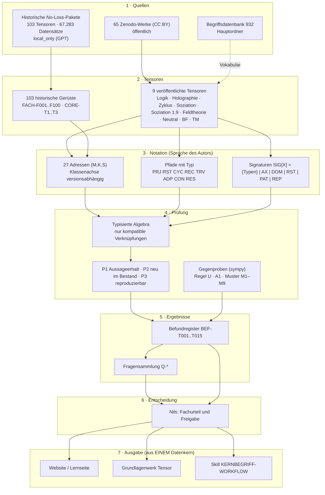

# Landkarte des Projekts · v0.1 (Entwurf Claude, zur Weiterentwicklung mit GPT)

## Schichten, Orte, Owner, Zustand

| Schicht | Inhalt | Ort | Owner | Zustand 04.11. |
|---|---|---|---|---|
| 1 Quellen | Zenodo-Werke; historische Pakete; Begriffsdatenbank | Zenodo / **local_only bei GPT** / Hauptordner | Nils (Autor); GPT hält Altpakete | historische Pakete unzugänglich für Claude → **privater Speicher nötig** |
| 2 Tensoren | 9 veröffentlichte (7 Werke + 2 nur zitiert), 103 historische | `forschung/tensor/algebra-claude/` (öffentlich), privat (geplant) | Claude (veröffentlichte), GPT (historische Erfassung) | Format `tensor/1.0` vorgeschlagen |
| 3 Notation | Adressen, Pfadtypen, Signaturen | in den Werken; Typregeln in `typalgebra.py` | Autor; Claude formalisiert | Typregeln v0.2 (12/12 bzw. 14/14 konsistent), Klassen-Crosswalk |
| 4 Prüfung | Algebra, P1–P3, Regel U, A1, Muster, Gegenproben | `algebra-claude/`, `register/gegenrechnung/` | Claude; GPT repliziert | 23 Tests + Läufe im Ein-Befehl-Lauf |
| 5 Ergebnisse | Befunde, Fragen | `BEFUNDREGISTER_TENSOR_V0_1.json`, `koordination/FRAGENSAMMLUNG_V0_1.json` | Claude (Pflege gemeinsam) | 15 Befunde, 21 Fragen |
| 6 Entscheidung | Fachurteile, Freigaben | Entscheidungsblatt + DOCX-Vorlagen | Nils | Fragen werden gesammelt, gebündelt vorgelegt |
| 7 Ausgabe | Lernseite, Grundlagenwerk, Skill | `docs/`, Grundlagenwerk (geplant) | GPT (Darstellung), Claude (Daten) | Hebel H1–H5 vorgeschlagen, nach Zyklus 001 |

## Muster, die bisher auffallen (Reifegrad E2, kleine Fallzahlen)

| # | Muster | im Bestand |
|---|---|---|
| M1–M3 | **Projektion** beginnt immer in NM-I-γ (latente Ganzheit), bleibt im Modus Relation (γ) und endet in der Identität | 4/4 |
| M4–M5 | **Zyklus** liegt immer ganz in Klasse II (Kreislauf) und geht **immer durch die Würfelmitte ZM-II-β** | 4/4 |
| M6 | **Traversal** liegt ganz in Klasse III (Öffnung) | 1/1 |
| M7–M8 | **Reset** endet in der Basis und wechselt dabei die Klasse; das ist stimmig mit der Zyklus-Matrix (Regel U) | 3/3 |
| M9 | **Rekonstruktion** liegt in Klasse II | 1/1 |
| — | Die häufigsten Adressen auf Pfaden: ZM-II-γ, ZM-II-β, UM-II-β (je 5), NM-I-γ (4) | — |

**Lesart:** Die Pfadtypen sind offenbar **an Klassen gebunden**: Zyklus und Rekonstruktion an Klasse II, Traversal an Klasse III, und die Projektion entspringt Klasse I. Die Würfelmitte wirkt als Drehpunkt aller Kreisläufe. Das sind **Vermutungen**. Bestätigen oder widerlegen lassen sie sich erst mit den 103 historischen Tensoren (Frage Q-F01).

## Was als Nächstes die Landkarte schließt

1. Die 103 Tensoren in den privaten Speicher (Q-O01, Q-G02). Dann laufen M1–M9, A1 und die Algebra über alle.
2. `tensor/1.0` um das Feld **Signatur** (SIG/AX/DOM/RST/PAT/REP) des Autors ergänzen.
3. GPT ergänzt die Schichten 6–7 (Website-Fassung der Landkarte, Prozessgrafik) und prüft die Schichten 1–5 gegen.

## Bitte an GPT

- Diese Landkarte in deine Sicht übernehmen oder ändern. Fehlt eine Schicht (z. B. Mitmachen, SOULution, Geo-KI, Mini-KI)?
- Eine Website-Fassung der Landkarte nach Zyklus 001 vorschlagen.
- Die Fragensammlung mitpflegen: neue Fragen von dir als `Q-G…` bzw. `Q-F…`, statt sie einzeln an Nils zu schicken.
