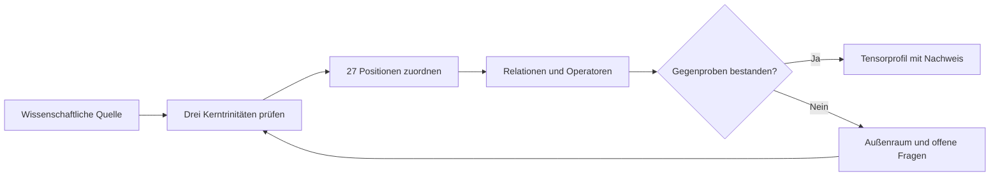
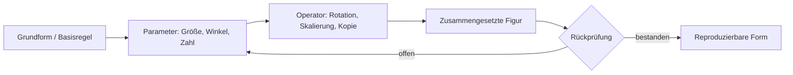

# Tensor – Diagrammquellen (Mermaid) v1

Die Diagramme sind fachliche Illustrationen. Browserdarstellungen nutzen zusätzlich statische SVG-Fassungen, damit Navigation und Textalternativen ohne externes Skript funktionieren.

## Der Weg zum selbst geprüften Tensor

## Parametrische Geo-KI

## Quellen, Gestaltung und Umsetzung
Ausgewählte Beispiele und Grafiken müssen mit Originalquelle, Lizenzen, Bildunterschrift, Alttext, Variablen und versionsgebundenem Output präsentiert werden. Mermaid-Quelltext dient als reproduzierbare Struktur, nicht als Ersatz für fachliche Feldakten. Eigene Beispielzahlen aus Visualisierungen sind als theoretische Parameterkombinationen zu kennzeichnen.
